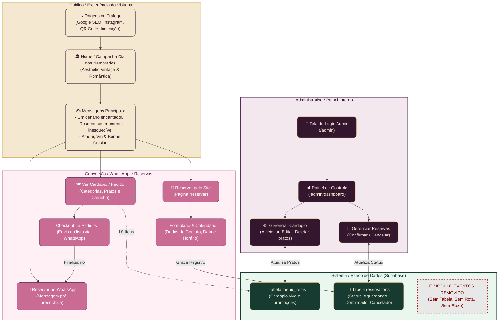

# Fluxograma Geral - Bistrot de Ville

Este documento descreve a arquitetura operacional e o fluxo de dados do **Bistrot de Ville**, um site funcional de gastronomia francesa romântica localizado na Vila Mariana, São Paulo. 

A arquitetura é dividida em **4 áreas funcionais coloridas** para mapear com precisão a jornada do visitante, as ferramentas de conversão, a persistência no banco de dados e o controle administrativo. Além disso, documenta e sinaliza formalmente a **remoção completa do módulo de Eventos** da plataforma.

---

## 🎨 Paleta de Cores e Identidade Visual (Dia dos Namorados & Vintage)
As cores utilizadas tanto na documentação quanto no sistema interativo seguem o conceito romântico francês:
- 🍷 **Vinho Profundo (`#34172E`)**: Identidade de marca, painel administrativo e rodapé.
- 🍇 **Ameixa (`#5B2858`)**: Botões secundários, títulos em foco e links estruturais.
- 🌸 **Rosa Floral (`#C96B93`)**: Conversão direta, corações e destaques românticos.
- 🌲 **Verde Bistrô (`#173B31`)**: Sistema, tabelas de banco de dados e logs internos.
- ⚜️ **Dourado Vintage (`#D9B76F`)**: Bordas premium, estrelas de avaliação e tipografia serifada.
- 🥛 **Creme (`#F5E8D0`)**: Fundo geral do site, contrastes suaves e legibilidade de textos.

---

## 🗺️ Fluxograma Operacional em 4 Raias Coloridas

O diagrama a seguir está dividido em subgrupos representando os domínios do sistema. Cada área tem uma identidade cromática única. O fluxo de **Eventos** é demonstrado com estilo cinza carmim riscado e marcado explicitamente como **[REMOVIDO]**.

---

## 🚫 Detalhes da Remoção de Eventos

Para garantir clareza no desenvolvimento e no alinhamento comercial com o cliente, o módulo de **Eventos** foi formal e intencionalmente expurgado. 

### O que foi removido?
1. **Público (Navegação):** Nenhuma aba, banner ou chamada comercial para locação de espaço ou shows acústicos.
2. **Formulário de Reservas:** Não há opção para selecionar tipo de evento corporativo ou casamento. O sistema foca 100% em **Reservas de Mesas para Refeição**.
3. **Painel Administrativo:** Removida a tela de "Gerenciar Eventos" ou calendário de locações.
4. **Banco de Dados (Supabase/PostgreSQL):**
   - **Tabela `events`:** Totalmente excluída.
   - **Tabela `reservations`:** Não possui relacionamento ou chave estrangeira para eventos.
5. **SEO:** Removidas palavras-chave relacionadas a "aluguel de espaço Vila Mariana" ou "festas corporativas" para evitar captação de leads fora de escopo.

---

## ⚙️ Arquitetura Funcional de Banco de Dados

O banco de dados é simplificado e robusto, contendo apenas duas entidades de controle:

### 1. Tabela `menu_items`
Responsável pelo cardápio dinâmico do restaurante.

| Campo | Tipo | Descrição |
|---|---|---|
| `id` | UUID (PK) | Identificador exclusivo do prato |
| `name` | VARCHAR | Nome do prato (ex: *Filet Mignon au Poivre*) |
| `description` | TEXT | Ingredientes e descrição romântica do preparo |
| `price` | NUMERIC / JSON | Valor unitário (ou JSON para tamanhos/opções) |
| `category` | VARCHAR | Ex: *Entradas, Pratos Principais, Sobremesas, Bebidas* |
| `image` | VARCHAR | URL da imagem hospedada ou Unsplash |
| `is_promoted` | BOOLEAN | `true` para figurar nas "Destaques / Promoções" da Home |
| `promotion_label` | VARCHAR | Rótulo (ex: *"Especial Dia dos Namorados"*) |
| `promotional_price`| NUMERIC | Preço com desconto aplicado durante o mês de junho |

### 2. Tabela `reservations`
Responsável pelo agendamento direto de mesas via sistema.

| Campo | Tipo | Descrição |
|---|---|---|
| `id` | UUID (PK) | Identificador exclusivo da reserva |
| `name` | VARCHAR | Nome do cliente |
| `email` | VARCHAR | E-mail do cliente |
| `phone` | VARCHAR | WhatsApp de contato |
| `date` | DATE | Data agendada para o jantar |
| `time` | TIME | Horário da reserva (ex: *19:30, 21:00*) |
| `guests` | INTEGER | Número de pessoas (foco em casais) |
| `status` | VARCHAR | Status atual: `Aguardando`, `Confirmado` ou `Cancelado` |
| `notes` | TEXT | Restrições alimentares ou observações especiais |

---

## 🎯 Estratégia de SEO Integrada

Para atrair o tráfego correto na Vila Mariana e São Paulo, o site foi desenvolvido com tags semânticas sólidas (`H1` único, cabeçalhos hierárquicos e estruturação via microdados `JSON-LD Restaurant`). As palavras-chave centrais mapeadas no fluxo são:

1. **Restaurante francês em São Paulo** (Posicionamento Premium)
2. **Restaurante romântico em São Paulo** (Atração Sazonal e de Casais)
3. **Dia dos Namorados São Paulo** (Pico de Tráfego em Junho)
4. **Bistrot de Ville Vila Mariana** (SEO Local e buscas de proximidade)
5. **Gastronomia premiada** (Garantia de autoridade e valor percebido)
